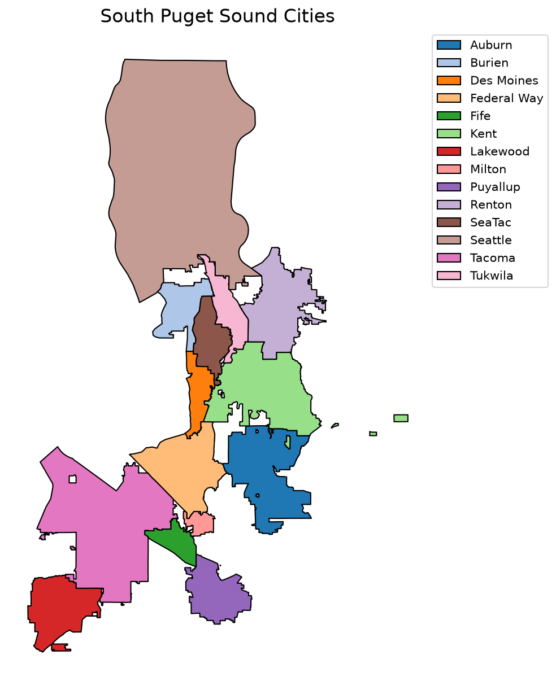

# Puget Sound Cities: Mapping South Puget Sound with Python



## Overview

This project maps 14 cities in South Puget Sound, Washington, from Seattle to Tacoma, centered on Federal Way. It uses open Census data and Python to filter, reproject and measure city boundaries, and produces both a static and an interactive map.

## Results

Federal Way covers about **23.7 square miles** and ranks **6th in size** among the 14 cities, just behind Renton.

| Rank | City | Area (sq mi) |
|---|---|---|
| 1 | Seattle | 142.09 |
| 2 | Tacoma | 62.43 |
| 3 | Kent | 34.42 |
| 4 | Auburn | 29.86 |
| 5 | Renton | 25.27 |
| 6 | **Federal Way** | **23.72** |
| 7 | Lakewood | 18.89 |
| 8 | Puyallup | 14.47 |
| 9 | Burien | 11.19 |
| 10 | SeaTac | 10.24 |
| 11 | Tukwila | 9.60 |
| 12 | Des Moines | 7.41 |
| 13 | Fife | 5.96 |
| 14 | Milton | 2.82 |

The full table is also saved as `city_area_ranking.csv`.

## Data

- [U.S. Census Bureau TIGER/Line 2024: Places (Washington)](https://www2.census.gov/geo/tiger/TIGER2024/PLACE/)

## Methods

1. Loaded Washington city boundaries with GeoPandas
2. Filtered to 14 South Puget Sound cities by name
3. Reprojected from NAD83 (EPSG:4269) to Washington State Plane South, US feet (EPSG:2927), for accurate area measurement
4. Calculated each city's area in square miles and ranked the cities by size
5. Created a static map (matplotlib) and an interactive web map (folium)

## Tools

Python, GeoPandas, pandas, matplotlib, folium, JupyterLab

## Limitations

- Census city boundaries include some water, so areas are total area, not land area. Seattle's total includes parts of Lake Washington and Puget Sound; its land area alone is about 84 square miles.
- The interactive map (`explore()`) displays inside JupyterLab but not on GitHub's notebook preview.

## How to run

```
conda create -n gis -c conda-forge python=3.12 geopandas jupyterlab matplotlib folium
conda activate gis
jupyter lab
```

Then open `puget_sound.ipynb` and choose Run → Run All Cells.

## Related project

This boundary file is reused in [South King County Flood Risk Analysis](https://github.com/shaerlimtiaco/south-king-flood-risk), which measures flood exposure for five of these cities.

## Author

Shae Limtiaco · [GitHub](https://github.com/shaerlimtiaco)